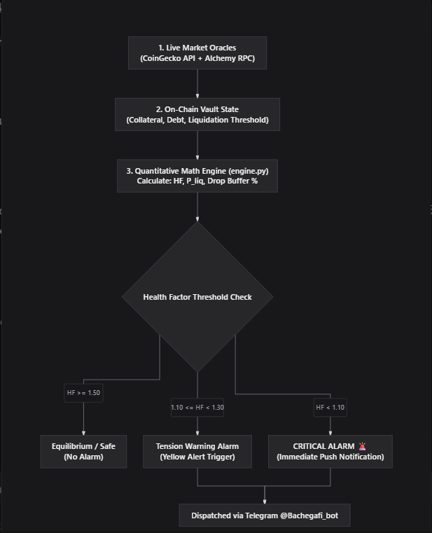

# Bachega.fi (बचेगा) - Individual User DeFi Risk & Crash Simulation Workbench

<div align="center">


[](https://celestia-ivory-three.vercel.app)
[](https://t.me/Bachegafi_bot)
[](https://python.org)
[](https://fastapi.tiangolo.com)
[](https://react.dev)

**"Markets Crash. You Don't Have To."**  
*Read-only deterministic liquidation modeling, 5-defense shock simulations, and quantitative push alarms for retail DeFi borrowers.*

[🌐 Live Web Dashboard](https://celestia-ivory-three.vercel.app) • [🤖 Telegram Bot (@Bachegafi_bot)](https://t.me/Bachegafi_bot) • [📖 API Docs (Swagger)](http://localhost:8000/docs)

</div>

---

> ⚠️ **MANDATORY REGULATORY DISCLAIMER: SIMULATION, NOT PREDICTION.**  
> Bachega is a strictly **read-only, non-custodial** risk analytics workbench. It contains no vault-operator controls, never requests or stores private keys, and executes zero automated on-chain transactions. All metrics, liquidation price projections, and stress-test recommendations are hypothetical quantitative models designed for decision support.

---

## 🧭 Executive Summary

Retail borrowers on decentralized lending protocols like **Aave v3**, **Compound v3**, and **Spark Protocol** routinely face catastrophic liquidation penalties (5% to 15% bonus losses) during sudden flash crashes. 

**Bachega.fi** bridges the gap between complex on-chain debt positions and actionable risk mitigation by providing:
1. **Real-Time Position Tracking**: Unified monitoring of volatile collateral (ETH, WBTC, ARB) and stable debt (USDC, USDT, DAI).
2. **Deterministic Stress Engine**: Real-time evaluation of price shocks (-10% to -50%) across **5 quantitative defense strategies**.
3. **Automated Alarm Dispatch**: Continuous Health Factor ($HF$) surveillance with multi-tier early warning push notifications delivered directly to your device via **Telegram ([@Bachegafi_bot](https://t.me/Bachegafi_bot))**.
4. **Resilient Dual Architecture**: Seamless full-stack support with Python FastAPI backend and zero-latency client fallback mode for decoupled static web deployments (Vercel + Supabase).

---

## 📊 Market Analysis & Quantitative Alarm Architecture

The diagram below illustrates Bachega's end-to-end mathematical analysis and alert pipeline:

<div align="center">



</div>

### 🔄 The 4-Stage Quantitative Alarm Workflow

```
[1. Live Market Oracles] ───────┐
 (CoinGecko API + Alchemy Node) │
                                ├──► [3. Quantitative Math Engine] ──► [4. Health Factor Threshold Check]
[2. On-Chain Vault State] ──────┘       (engine.py / client math)         ├─► HF >= 1.50   ── Safe (No Alarm)
 (Collateral, Debt, Threshold)          (HF, P_liq, Drop Buffer %)        ├─► 1.10 <= HF < 1.30 ── Warning Alarm
                                                                           └─► HF < 1.10    ── CRITICAL ALARM 🚨
                                                                                                      │
                                                                           [Dispatched via @Bachegafi_bot]
```

#### Stage 1: Live Market Oracles
- Ingests spot prices and 24h market trends via **CoinGecko API** with a 60-second TTL cache to eliminate rate limits.
- Validates on-chain wallet balances and token states across Ethereum, Arbitrum, Optimism, Base, and Solana via **Alchemy RPC Nodes**.

#### Stage 2: On-Chain Vault State
- Retrieves current asset collateral breakdown, outstanding debt balances, and protocol-specific liquidation thresholds ($LT$).
- Normalizes collateral values ($C$) and debt liabilities ($D$) into USD pegged baselines.

#### Stage 3: Quantitative Math Engine (`engine.py`)
Computes essential risk coordinates in real time:

1. **Health Factor ($HF$)**:
   $$\text{Health Factor} = \frac{\sum_{i} (C_i \times P_i \times LT_i)}{D_{\text{total}}}$$
2. **Liquidation Price ($P_{\text{liq}}$)**:
   $$P_{\text{liq}} = \frac{D_{\text{total}} - \sum \text{Stable Capacity}}{C_{\text{volatile}} \times LT_{\text{volatile}}}$$
3. **Liquidation Drop Buffer ($\Delta P_{\text{buffer}}$)**:
   $$\Delta P_{\text{buffer}} = \frac{P_{\text{spot}} - P_{\text{liq}}}{P_{\text{spot}}} \times 100\%$$

#### Stage 4: Health Factor Threshold Check & Alert Dispatch
The mathematical engine classifies vault health into three discrete operational states:
- 🟢 **$HF \ge 1.50$ (Equilibrium / Safe)**: Normal market conditions. Position holds ample buffer; no notifications sent.
- 🟡 **$1.10 \le HF < 1.30$ (Tension Warning Alarm)**: Yellow alert triggered. Volatility has eroded more than 50% of the safety buffer. A cautionary advisory is dispatched to Telegram.
- 🔴 **$HF < 1.10$ (CRITICAL ALARM 🚨)**: Red alert triggered immediately. The vault is within 10% of forced liquidation. Dispatches high-priority push notifications with actionable deleveraging recommendations.

---

## 🛡️ The 5 Quantitative Defense Strategies

When stress-testing a vault under flash crashes (-10% to -50%), Bachega evaluates five distinct survival actions:

| Strategy | Mechanism | Capital Required | Trade-off / Impact |
|---|---|---|---|
| **1. Do Nothing** | Passive baseline tracking | $0.00 | Full exposure to collateral decay; highlights exact liquidation trigger price. |
| **2. Repay Debt** | Targeted stablecoin debt paydown | Moderate USDC/USDT | Immediately resets $HF \ge 1.50$ while preserving entire collateral upside. |
| **3. Add Collateral** | Inject stable or volatile assets | Moderate assets | Widens the liquidation distance without paying down low-interest debt. |
| **4. Collateral Swap** | Rebalance high-beta assets to low-beta/stables | Zero outside capital | Reduces portfolio volatility and volatility-adjusted liquidation risk. |
| **5. Partial Deleverage** | Flash-unwind collateral to extinguish debt | Zero outside capital | Eliminates liquidation risk autonomously without requiring outside cash injection. |

---

## 🤖 Telegram Bot Integration (`@Bachegafi_bot`)

Bachega features a dedicated, 24/7 Telegram assistant: **[@Bachegafi_bot](https://t.me/Bachegafi_bot)**.

### Features
- **Real-Time Push Alerts**: Instant notification when market movements push your Health Factor into Warning or Critical bands.
- **Direct Numeric Chat ID Authentication**: Quick connection without complex auth tokens. Enter your numeric Chat ID on the web dashboard to instantly verify delivery.
- **Natural Language Risk Queries**:
  - `/start` or `/help`: Command reference and bot overview.
  - `"Check my wallet"`: Fetches real-time collateral, debt, and aggregate Health Factor.
  - `"Simulate 35% crash"`: Evaluates a 35% flash crash across all your monitored vaults.
  - `"What if ETH drops to $1800?"`: Calculates custom liquidation thresholds and required debt paydown.
  - `"Explain the 5 strategies"`: Detailed overview of all defense mechanisms.

---

## 🌐 Live Deployments & Endpoints

| Environment | Service | URL / Link | Status |
|---|---|---|---|
| **Frontend** | Vercel Live Web App | [https://celestia-ivory-three.vercel.app](https://celestia-ivory-three.vercel.app) | 🟢 Live |
| **Telegram Bot** | Cloud Assistant | [https://t.me/Bachegafi_bot](https://t.me/Bachegafi_bot) (`@Bachegafi_bot`) | 🟢 Live |
| **Backend API** | Render / Local FastAPI | `http://localhost:8000` (or Render web service) | 🟢 Active |
| **Database** | Supabase + LocalStorage | Cloud sync with offline fallback | 🟢 Active |

---

## 💻 Local Development Setup

### 1. Prerequisites
- Python 3.11+
- Node.js 18+ and npm
- Telegram account (for alert testing)

### 2. Backend Installation

```bash
# Clone the repository
git clone https://github.com/indiashubham01-hash/Celestia.git
cd Celestia

# Create and activate virtual environment
python -m venv .venv
# Windows:
.\.venv\Scripts\activate
# Linux/macOS:
source .venv/bin/activate

# Install dependencies
pip install -r requirements.txt
```

### 3. Environment Configuration

Create a `.env` file in the project root:

```env
PORT=8000
ENVIRONMENT=development
TELEGRAM_BOT_TOKEN=9021360110:AAHE5uS5WeBlGkrxFQOipIlRWlQoLfnpc5M
TELEGRAM_BOT_USERNAME=Bachegafi_bot
COINGECKO_API_KEY=your_key_here
ALCHEMY_API_KEY=your_key_here
SUPABASE_URL=https://your-project.supabase.co
SUPABASE_ANON_KEY=your_key_here
```

### 4. Running the Backend & Bot

```bash
# Start FastAPI backend
uvicorn main:app --reload --port 8000

# Start Telegram Bot polling service
python backend/bot.py
```

- **Swagger API Docs**: [http://localhost:8000/docs](http://localhost:8000/docs)
- **ReDoc**: [http://localhost:8000/redoc](http://localhost:8000/redoc)

### 5. Running the Frontend

```bash
cd frontend
npm install
npm run dev
```

- **Vite Local URL**: [http://localhost:5173](http://localhost:5173)

### 6. Running Test Suite

```bash
python test_app.py
```

---

## 📡 API Endpoints Reference

| Method | Endpoint | Description |
|---|---|---|
| `GET` | `/` | API status, version, and mandatory disclaimer banner |
| `GET` | `/api/health` | Liveness health check |
| `GET` | `/api/me` | User profile, notification handle, and onboarding status |
| `GET` | `/api/wallets` | List all monitored public wallet addresses |
| `POST` | `/api/wallets` | Add a monitored address (validates chain + EVM/Solana format) |
| `DELETE` | `/api/wallets/{wallet_id}` | Remove wallet from monitoring list |
| `GET` | `/api/portfolio` | Aggregated wallet balances and multi-protocol lending summaries |
| `GET` | `/api/positions` | List available lending position IDs |
| `GET` | `/api/positions/{id}` | Granular risk metrics: Health Factor, LTV, Liquidation Price, Proximity % |
| `POST` | `/api/simulations` | Execute hypothetical collateral shock simulation (-10% to -50%) |
| `GET` | `/api/alerts/preferences` | Retrieve alert thresholds and delivery channels |
| `PUT` | `/api/alerts/preferences` | Update alert thresholds (HF warning, critical, 24h price drop) |
| `POST` | `/api/alerts/link-channel` | Start authenticated Telegram / WhatsApp opt-in verification |
| `GET` | `/api/alerts/telegram/status` | Check if user is linked to Telegram |
| `POST` | `/api/alerts/telegram/register` | Register verified Telegram chat ID and username |
| `POST` | `/api/alerts/telegram/send-alert` | Push live quantitative liquidation warning directly to Telegram |

---

## 📁 Repository Structure

```
├── assets/                                 # Static branding and architecture diagrams
│   └── market_analysis_alert_pipeline.png  # Flowchart: Oracles -> Engine -> Alarms -> Telegram
├── docs/
│   └── images/
│       └── market_analysis_alert_pipeline.png
├── backend/                                # Backend package
│   ├── bot.py                              # Live Telegram bot (@Bachegafi_bot) polling daemon
│   └── requirements.txt                    # Service dependencies
├── frontend/                               # React 18 + Vite frontend
│   ├── src/
│   │   ├── components/                     # UI components (CrashSimulator, TelegramModal, etc.)
│   │   ├── api.js                          # Resilient API client with client-side shock math
│   │   └── App.jsx                         # Main dashboard layout
│   └── package.json
├── engine.py                               # Vectorized NumPy quantitative math engine
├── main.py                                 # FastAPI application and route definitions
├── schemas.py                              # Pydantic v2 strict models and data validators
├── services.py                             # CoinGecko and Alchemy live data integration layer
├── db.py                                   # Thread-safe storage with Supabase synchronization
├── render.yaml                             # Infrastructure-as-code spec for Render deployment
├── requirements.txt                        # Root dependencies for cloud build runners
└── README.md                               # Project documentation
```

---

## ⚖️ License & Ethical Standards

Distributed under the **MIT License**.

- **Non-Custodial Design**: No private keys are ever collected or stored.
- **Simulation Disclaimer**: All risk scenarios represent mathematical projections, not price predictions or financial advice.
